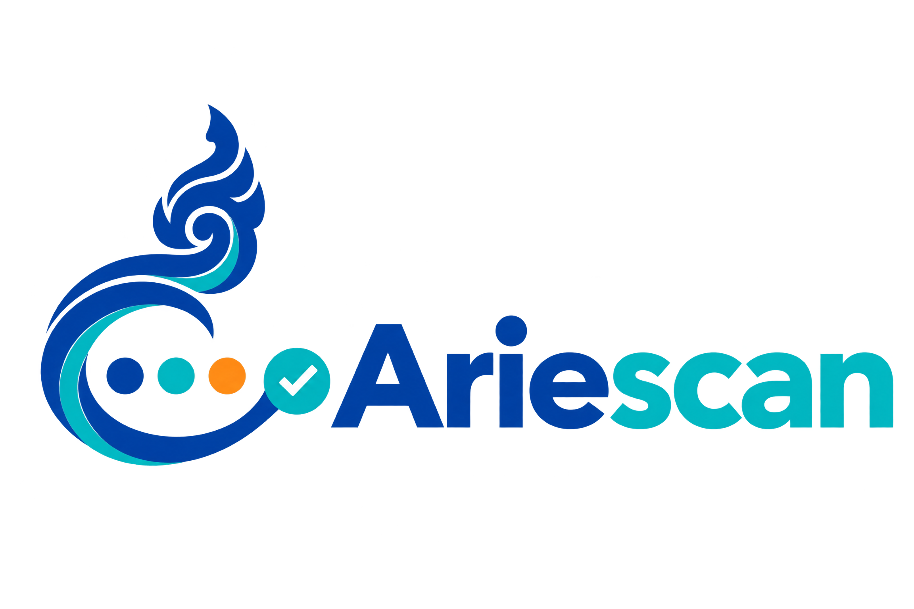

# Ariescan

**Open-Source Automated API Testing Platform**



---

## Overview

**Ariescan** is a free, open-source API testing platform that automatically discovers API endpoints, generates test cases, executes tests, and reports the results.

Instead of manually testing every endpoint in Postman, developers can use Ariescan to automate many of those tasks.

### For example:
- A developer builds a backend using **Spring Boot**, **FastAPI**, **Laravel**, or **Node.js**
- They run their backend locally and provide its URL and OpenAPI documentation to Ariescan
- Ariescan discovers the endpoints, generates tests, executes requests, and displays which tests passed or failed

---

## 🎯 Key Features

- ✅ **Automatic Endpoint Discovery** — From OpenAPI documentation
- ✅ **Intelligent Test Generation** — Without requiring AI
- ✅ **Multi-Method Testing** — GET, POST, PUT, PATCH, DELETE
- ✅ **Comprehensive Validation** — Response status codes, bodies, and schemas
- ✅ **Security Analysis** — Identifies unexpected behavior and common API security issues
- ✅ **Clear Test Reports** — Visual results and detailed analytics
- ✅ **Local-First** — Run everything locally without paying for hosting

---

## ⚙️ Requirements

- **Node.js** 16+ or **Python** 3.8+
- **Docker** & **Docker Compose** (optional, for containerized setup)
- A running backend API with OpenAPI/Swagger documentation

> **Important**: Ariescan tests the behavior of a running backend. Importing API documentation alone does not execute tests; the target backend must also be running and reachable.

---

## 🚀 Quick Start

### Option 1: Local Setup

#### Backend
```bash
cd backend
npm install        # or 'pip install -r requirements.txt' for Python
npm start          # or 'python app.py'
```

#### Frontend
```bash
cd frontend
npm install
npm start
```

### Option 2: Docker Setup

```bash
docker-compose up
```

The application will be available at:
- **Frontend**: http://localhost:3000
- **Backend API**: http://localhost:5000

---

## 📖 How to Use

1. **Start your target backend** (the API you want to test)
   ```bash
   # Example: FastAPI backend
   cd your-project
   python main.py
   ```

2. **Open Ariescan**
   - Navigate to `http://localhost:3000`

3. **Import your API**
   - Provide your API URL: `http://localhost:8000`
   - Upload or link your OpenAPI/Swagger documentation

4. **Generate & Run Tests**
   - Ariescan auto-discovers endpoints
   - Generates test cases
   - Executes all tests in parallel

5. **Review Results**
   - View detailed test reports
   - Analyze failures and security issues
   - Export reports (JSON, PDF)

---

## 📁 Project Structure

```
Ariescan/
├── backend/                    # REST API & Test Engine
│   ├── src/
│   ├── tests/
│   ├── Dockerfile
│   └── package.json
├── frontend/                   # React/Vue Dashboard
│   ├── src/
│   ├── public/
│   ├── Dockerfile
│   └── package.json
├── docker/                     # Docker Orchestration
│   └── docker-compose.yml
├── docs/                       # Documentation
└── README.md
```

---

## 🔧 Configuration

### Backend Environment Variables

Create a `.env` file in the `backend/` directory:

```env
PORT=5000
NODE_ENV=development
FRONTEND_URL=http://localhost:3000
LOG_LEVEL=info
```

### Frontend Environment Variables

Create a `.env` file in the `frontend/` directory:

```env
REACT_APP_API_URL=http://localhost:5000
REACT_APP_API_TIMEOUT=30000
```

---

## 🧪 Testing

```bash
# Backend tests
cd backend
npm run test

# Frontend tests
cd frontend
npm run test

# All tests with Docker
docker-compose -f docker/docker-compose.yml run --rm backend npm run test
```

---

## 📚 Documentation

See the [docs/](./docs/) folder for:
- [Installation Guide](./docs/INSTALLATION.md)
- [API Documentation](./docs/API.md)
- [Contributing Guidelines](./docs/CONTRIBUTING.md)
- [Architecture Overview](./docs/ARCHITECTURE.md)

---

## 🤝 Contributing

We welcome contributions! Please see [CONTRIBUTING.md](./docs/CONTRIBUTING.md) for guidelines.

1. Fork the repository
2. Create a feature branch (`git checkout -b feature/amazing-feature`)
3. Commit your changes (`git commit -m 'Add amazing feature'`)
4. Push to the branch (`git push origin feature/amazing-feature`)
5. Open a Pull Request

---

## 📄 License

This project is licensed under the **MIT License** — see the [LICENSE](./LICENSE) file for details.

---

## 🐛 Issues & Support

Found a bug? Have a feature request?

- **GitHub Issues**: [Report here](https://github.com/HorRatha/Ariescan/issues)
- **Discussions**: [Ask questions](https://github.com/HorRatha/Ariescan/discussions)
- **Email**: support@ariescan.dev

---

---

## 🙏 Acknowledgments

- Built with modern open-source tools and libraries
- Inspired by Postman, Insomnia, and API testing best practices

---

## 📈 Roadmap

- [ ] AI-powered test case generation
- [ ] Performance testing & load simulation
- [ ] Continuous integration plugins
- [ ] Advanced security scanning
- [ ] Team collaboration features
- [ ] Cloud hosting option

---

**Made with ❤️ by the Hor Ratha**

[⭐ Star us on GitHub!](https://github.com/HorRatha/Ariescan)
